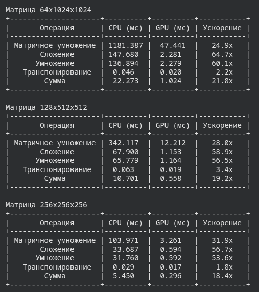

# Задание 3.4: анализ результатов

На текущей машине CUDA недоступна (`torch.cuda.is_available() = False`), поэтому сравнения проводились в google colab

## Какие операции получают наибольшее ускорение на GPU?

Сильнее всего ускоряется матричное умножение (`torch.matmul`). У этой операции высокая арифметическая интенсивность: на
каждый загруженный элемент приходится много сложений и умножений. GPU состоит из тысяч небольших вычислительных блоков.
Поэтому такую работу он делает параллельно и быстро.

Поэлементное сложение и умножение ускоряются меньше. Здесь нужно прочитать два массива и записать результат. Вычислений
немного и все упирается в пропускную способность памяти.

Сумма всех элементов тоже может ускоряться. Но обычно слабее матричного умножения. Это редукция: нужно сложить много
чисел и дождаться, пока GPU закончит работу.

Транспонирование обычно не ускоряется. PyTorch не копирует данные, а только меняет strides. Операция почти мгновенная и
на CPU, и на GPU. Если после этого вызвать `.contiguous()`, данные придется реально скопировать. Тогда скорость уже
будет зависеть от пропускной способности памяти.

## Почему некоторые операции могут быть медленнее на GPU?

Основные причины:

1. GPU нужно время на запуск ядра. Для маленьких массивов это время может быть больше самой работы.
2. Данные сначала нужно передать с CPU на GPU по PCIe. Для короткой операции передача может занять больше времени, чем
   вычисление.
3. Поэлементные операции и копирование упираются в пропускную способность памяти.
4. Иногда нужно синхронизироваться: дождаться, пока GPU закончит работу. Только потом можно забрать результат.
5. При маленьких данных часть GPU простаивает.
6. Выделение и освобождение памяти тоже занимают время.

## Как размер матриц влияет на ускорение?

Чем больше матрица, тем больше работы получает GPU. Тем выше ускорение. Но рост ограничен пропускной способностью
памяти.

На маленьких матрицах большую часть времени занимают служебные действия. Запуск ядра, передача данных, ожидание
результата. Поэтому GPU может быть медленнее CPU.

На больших матрицах время вычислений растет быстрее служебных затрат. Преимущество GPU становится заметным. Особенно на
матричном умножении.

Для операций, ограниченных памятью (memory-bound), размер тоже помогает. Но ускорение ограничено пропускной способностью
памяти.

## Что происходит при передаче данных между CPU и GPU?

Память CPU и GPU разделена. Чтобы GPU выполнил операцию, данные нужно скопировать в его память. Например, через
`.to("cuda")`.

Во время передачи:

1. Данные копируются по шине.
2. Копирование занимает время.
3. Обычная pageable-память копируется медленнее, чем pinned memory.
4. Результат нужно вернуть на CPU через `.to("cpu")` или `.cpu()`. Это нужно, если результат будет использоваться в
   обычном коде.
5. Передача не всегда идет одновременно с вычислениями.

В замерах задания время передачи не входит в `measure_time`. Тензор переносят на GPU до начала замера. Если учитывать
передачу, ускорение GPU будет меньше. Особенно для небольших данных.

Вывод: GPU дает наибольший выигрыш на больших задачах с большим числом вычислений. Прежде всего на матричном умножении.
На маленьких задачах и операциях с памятью ускорение может пропасть.
